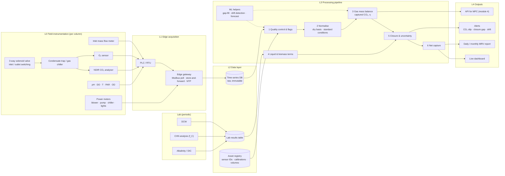

# CO₂ Capture and Fixation Tracker: System Architecture

_Status: ideation draft, 2026-11-07. Scope: module 2 of the Zero Algae roadmap, applied to the Algatek carbon capture and utilisation (CCU) photobioreactor (PBR)._

## 1. Purpose

The tracker answers two questions for every PBR column, continuously: how much CO₂ left the gas phase (captured), and how much of that carbon ended up in biomass (fixed). These two numbers are different, and the gap between them is where most over-claiming happens in microalgae CCU. Captured CO₂ can still sit in the medium as dissolved inorganic carbon (DIC), leave with the harvest liquid, or precipitate as carbonate, so only the fixed part is durable in the biomass.

The core of the tracker is a deterministic mass balance, not a machine learning (ML) model. This is deliberate, because a carbon number used for measurement, reporting and verification (MRV) must be auditable from sensor reading to final kilogram. ML enters only at the edges: filling sensor gaps, detecting analyser drift, and forecasting. The same pipeline later feeds module 1 (the DIC soft sensor) and module 4 (model predictive control, MPC).

## 2. Carbon accounting model

### 2.1 Gas-phase uptake (captured CO₂)

The uptake rate comes from the difference between the CO₂ entering and leaving the column. The outlet flow is not equal to the inlet flow, because the culture absorbs CO₂ and releases O₂. The tracker therefore uses an inert-gas balance (N₂ and Ar pass through unchanged) on a dry basis:

```
Q_out = Q_in × (1 − y_CO2,in − y_O2,in) / (1 − y_CO2,out − y_O2,out)

ṅ_CO2,captured = Q_in × y_CO2,in − Q_out × y_CO2,out        [mol/s]

η_capture = ṅ_CO2,captured / (Q_in × y_CO2,in)              [–]
```

Here `Q` is the dry molar gas flow (from a mass flow meter at its stated standard reference condition), and `y` is the dry mole fraction. This balance requires an O₂ reading on the outlet gas as well as CO₂. Without it, the O₂ produced by photosynthesis dilutes the outlet stream, so the tracker would overstate capture.

### 2.2 Liquid-phase and biomass terms (where the carbon went)

```
Captured = Fixed in biomass + ΔDIC in medium + Carbon in harvest liquid + Precipitated carbonate + Error

Fixed in biomass [kg CO₂] = ΔX [kg DCW/m³] × V [m³] × f_C × 44/12
```

`ΔX` is the change in dry cell weight (DCW), `V` is the working volume, and `f_C` is the biomass carbon fraction. A typical `f_C` near 0.50 gives about 1.83 kg CO₂ per kg DCW. However, the real value shifts with nitrogen stress, so it must be measured by CHN elemental analysis rather than assumed.

### 2.3 Closure check

The tracker compares gas-phase uptake against the sum of the liquid and biomass terms for each batch. A closure ratio near 1.0 shows that the sensors and the lab data agree. A persistent gap points to a leak, a drifting analyser, or an unmeasured carbon sink, and the report flags it instead of hiding it.

### 2.4 Net capture

```
Net CO₂ = Fixed CO₂ − (E_blower + E_pumps + E_chiller + E_lights) × EF_grid
```

`EF_grid` is the grid emission factor. A placeholder of about 0.8 kg CO₂/kWh is used for planning only and must be replaced with the official factor for the grid that supplies the site. This term decides whether the system is carbon-negative at all, because an over-aerated PBR on a coal-heavy grid can emit more through its electricity than it fixes. The source of the inlet CO₂ also matters: CO₂ from flue gas counts as capture, while bottled CO₂ that was itself produced from fossil sources does not.

## 3. Architecture overview



## 4. Layer details

### L0 Field instrumentation

The single most important design choice is to measure inlet and outlet gas with **the same analyser**, switched by a solenoid valve on a fixed cycle (for example 5 minutes inlet, 5 minutes outlet). The capture efficiency is a ratio of two similar numbers, so any gain error in two separate analysers goes straight into the result. A single switched analyser cancels its own gain error in that ratio, and it also halves the analyser cost. The trade-off is that the tracker sees each stream only half the time, which is acceptable because gas composition in a PBR changes over minutes, not seconds.

The gas must be dried by a condensate trap or a small chiller before it reaches the analyser, because water vapour dilutes the sample and most non-dispersive infrared (NDIR) sensors report a wet-basis reading. If the current inlet flow is measured with a rotameter, it should be replaced with a thermal mass flow meter for this purpose. A rotameter is read by eye, depends on gas density and pressure, and typically carries an uncertainty of several percent of full scale, which is too coarse for MRV.

| Measurement | Suggested instrument | Why it is needed |
|---|---|---|
| Inlet gas flow | Thermal mass flow meter, ±1% of reading | Gives `Q_in` at a known standard condition |
| CO₂ in/out | NDIR analyser, range matched to the inlet CO₂ (for example 0–20% for flue gas) | Gives `y_CO2,in` and `y_CO2,out` |
| O₂ out | Electrochemical or paramagnetic sensor | Needed for the inert-gas balance |
| Gas temperature and pressure at analyser | RTD and pressure transmitter | Corrects readings to standard conditions |
| Liquid pH, DO, T, PAR, optical density (OD) | Existing probes | Context for QC, and inputs for modules 1 and 3 |
| Electricity | Power meter per major load | Net capture calculation |

### L1 Edge acquisition

A programmable logic controller (PLC) or remote terminal unit (RTU) reads the field instruments and controls the switching valve. An edge gateway polls the PLC over Modbus every 1–10 seconds, timestamps every reading from an NTP-synchronised clock, and records the valve state with each sample so that the pipeline knows which stream each CO₂ reading belongs to. The gateway also buffers data locally (store-and-forward), so a network outage at site does not create a hole in the carbon record.

### L2 Data layer

Raw readings go into a time-series database (for example TimescaleDB or InfluxDB) and are never edited. Every correction happens downstream, which keeps the audit trail intact. Lab results (DCW, CHN, alkalinity, DIC) go into a separate table with sample time, method and analyst. An asset registry holds the metadata that the calculations need: sensor serial numbers, calibration dates and gas certificates, column working volumes, and the standard reference condition of each flow meter.

### L3 Processing pipeline

The pipeline runs in fixed steps, and every step writes its output with a version tag so that any reported number can be recomputed later.

1. **Quality control.** Each reading is checked for range, flat-lining, spikes and calibration age. The first minute after each valve switch is discarded as settling time. Readings are flagged, not deleted.
2. **Normalisation.** Flows and concentrations are converted to dry basis at one standard reference condition.
3. **Gas mass balance.** Each paired inlet/outlet cycle produces one uptake rate and one capture efficiency, which are then integrated to kilograms per hour, day and batch.
4. **Liquid and biomass terms.** Fixed carbon comes from DCW samples times the measured `f_C`, interpolated between samples. ΔDIC comes from lab alkalinity and DIC at first, and later from the module 1 soft sensor.
5. **Closure and uncertainty.** The closure ratio is computed per batch, and the uncertainty of every reported figure is propagated from instrument specifications by Monte Carlo sampling.
6. **Net capture.** Energy use is converted to emissions with the grid factor and subtracted.

The ML helpers sit beside this chain. A gap-filling model estimates uptake during short sensor dropouts, but every gap-filled value is marked and reported separately from measured values. A drift detector compares the analyser's inlet reading against the known source composition and against neighbouring columns to catch slow calibration drift. A short-horizon forecaster predicts the next few hours of uptake for the MPC in module 4.

### L4 Outputs

The live dashboard shows, per column, the capture efficiency, the uptake in kg CO₂ per day, the closure ratio and the specific energy in kWh per kg CO₂. Alerts fire when CO₂ slip rises (low efficiency with high inlet flow, which means the dosing should be reduced), when closure drifts away from 1.0, or when the analyser drifts. The MRV report lists gross capture, fixed carbon, net capture, uncertainty, and the share of gap-filled data. An API exposes the same rates so that the MPC can use them as feedback.

## 5. Why the uncertainty design matters

Capture efficiency is calculated from the difference between two similar concentrations, so small sensor errors become large relative errors whenever capture is low. Consider an inlet at 10% CO₂ and an outlet at 8% CO₂, which gives an efficiency of about 20%. If two separate analysers each carry an independent ±2% relative error, the efficiency becomes 0.20 ± 0.023, which is ±11% in relative terms. With a single switched analyser, the gain error cancels in the ratio and only offset and linearity errors remain, so the uncertainty drops sharply. This is the main reason for the single-analyser design in Section 4.

## 6. KPI definitions

| KPI | Definition | Unit |
|---|---|---|
| Capture efficiency, η | Captured CO₂ ÷ CO₂ fed | % |
| Gross capture rate | Captured CO₂ per unit time and per unit volume | kg CO₂ m⁻³ d⁻¹ |
| Fixation rate | CO₂ fixed in biomass per unit time and volume | kg CO₂ m⁻³ d⁻¹ |
| Closure ratio | (Fixed + ΔDIC + harvest carbon) ÷ captured CO₂ | – |
| Specific energy | Electricity used ÷ CO₂ fixed | kWh kg⁻¹ CO₂ |
| Net capture | Fixed CO₂ − electricity emissions | kg CO₂ |
| Data completeness | Share of time with measured (not gap-filled) uptake | % |

## 7. Phased build

| Phase | Work | Exit criterion |
|---|---|---|
| 0. Audit | List existing sensors, PLC, data logging and CO₂ source per column; identify gaps against Section 4 | Gap list and instrument budget approved |
| 1. Single column | Install switched analyser, O₂ sensor and mass flow meter on one column; build L1–L3 steps 1–3 | Continuous captured-CO₂ record for one full batch |
| 2. Closure campaign | Run at least three batches with daily DCW, CHN, alkalinity and DIC samples | Closure ratio within an agreed band, with an uncertainty budget |
| 3. Scale and report | Extend to all columns, add net capture, dashboard, alerts and MRV report; add ML gap-fill and drift detection | Monthly report generated automatically and checked against the lab |

## 8. Open questions

1. What is the CO₂ source for each column: flue gas, biogas, or bottled CO₂? This changes both the analyser range and whether the inlet CO₂ counts as capture.
2. Which gas and liquid sensors are installed today, and is inlet flow currently measured by a rotameter or a mass flow meter?
3. How many columns are there, what is each working volume, and do they share one gas header or have separate feeds?
4. What PLC or logger is in place, and is any data already being stored?
5. Is the target a carbon-credit registry, a client report, or internal R&D? A registry methodology would set the minimum monitoring frequency, the allowed gap-filling rules, and the uncertainty deductions.
